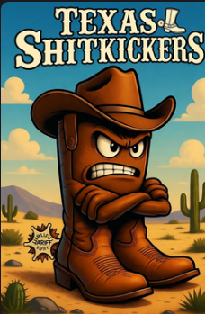
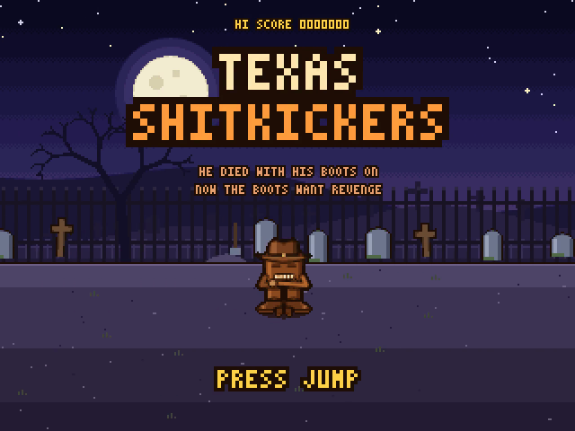
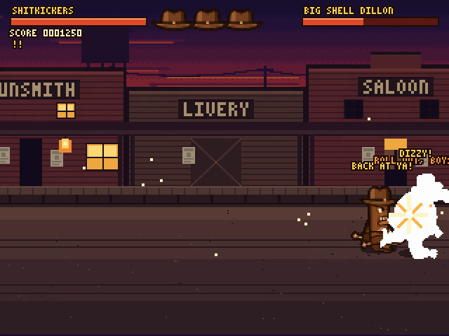
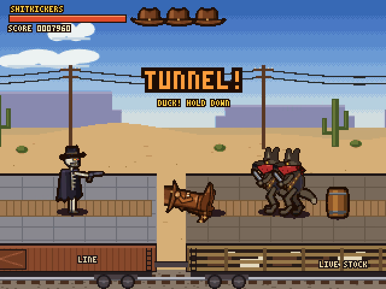
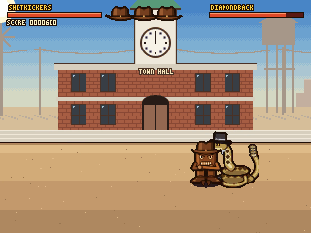

# Texas Shitkickers



**Ringo was in the way. The Diamondback Gang gunned him down and buried him on Boot Hill, with his boots on.
Ringo stayed dead. His boots didn't.**

A side-scrolling brawler in the style of Final Fight and Double Dragon, for the **Wildbits F256** (K2) under
**NitrOS-9 Level 2**, written in 6809 assembly. The Shitkickers - a pair of cowboy boots with a face, a hat, stubby
arms and a grudge - climb out of Ringo's grave and kick their way through the Diamondback Gang and its undead
posse: seven stages, seven bosses, a high-noon duel and an ending, with rockabilly and blues music on the F256's
SAM2695 synth.

It was designed first as a browser game held to the F256's display rules, then translated by hand into 6809, so
there are two playable versions here: the browser prototype and the F256 game.

<br clear="right">

| | |
|---|---|
|  |  |
|  |  |

*Screenshots from the F256 version (in MAME).*

## Play it

**In a browser:** open `game/index.html` (no build, no server). Arrows move (up and down walk into and out of the
street), Z or space jumps, X kicks (three for a combo), back + X or C is the side kick; Z then X is a flying kick,
Z then Z a stomp. `game/README.md` has the full move list and the gang.

**On an F256 (K2):** build the release with `make dist` in `f256/` (or use a release zip, if there is one): it
holds `CMDS/tsk`, the `TSK/` folder and a README with the install steps. On the machine:

```
chd /dd/TSK
tsk
```

It needs about 1.7 MB of free memory. Keys: arrows, Z or space to jump, X to kick, C side kick, T taunt, Q quit.
To build it yourself, see `f256/README.md`.

## How it's made

- **`f256/ARCHITECTURE.md`** - how the whole thing is put together: the browser-first approach, the asset pipeline,
  the runtime (stage modules, sprite banks, the frame loop, sound), testing, and the pitfalls. Written to be used
  as a worked example for a new F256 game.
- **`f256/docs/port-plan.md`** - the port, step by step, and what each step found.
- **The F256 porting guide** that this game followed and added to: https://github.com/jfed6000/f256_porting

## Copyright and licence

The characters are copyright 2026 by John Federico.

The code is free, as long as you don't charge for it, and if you share it (or anything made from it), pass the
license on with it. See [`LICENSE`](LICENSE).
